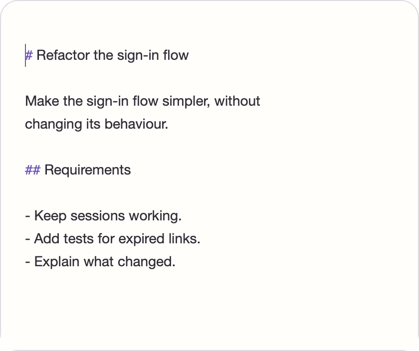
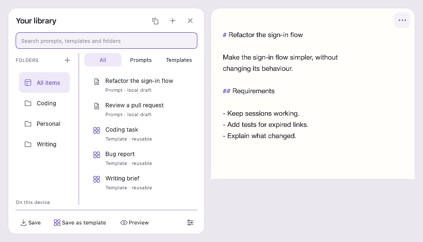
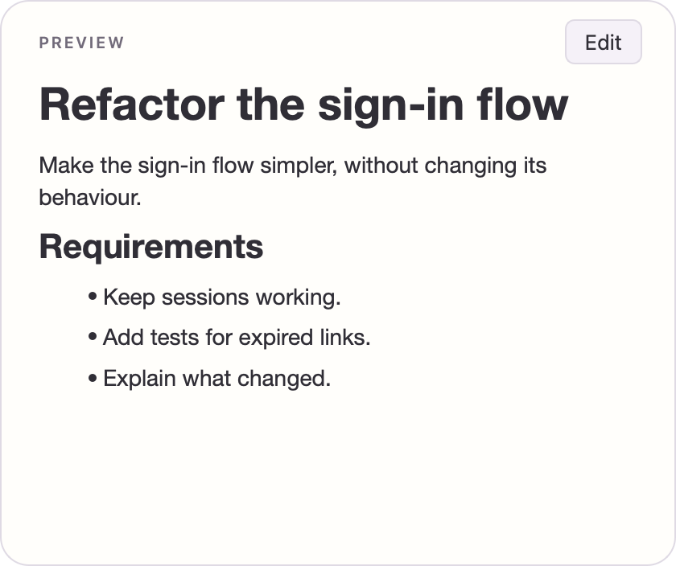

# PromptPad

**A native, offline editor for writing long prompts to Claude Code, Codex and other coding agents.**

[](https://github.com/aaravchour/PromptPad/releases)
[](https://github.com/aaravchour/PromptPad/actions/workflows/build.yml)
[](LICENSE)


Writing a 40-line prompt in a one-line terminal input is painful. PromptPad is the editor that opens when your agent asks for one: write comfortably in Markdown, press **Save and return**, and the text goes straight back to the agent.

It never calls AI, makes no network requests, has no telemetry and needs no account. Your prompts stay plain UTF-8 files on your machine.

<!-- Demo GIF goes here: agent prompt → edit key → PromptPad opens → Save and return → agent runs. -->



## Quick start

1. Download the [PromptPad 0.1.0 macOS Apple Silicon preview](https://github.com/aaravchour/PromptPad/releases/tag/v0.1.0), unzip it and move `PromptPad.app` to `/Applications`. The build is not yet notarised; if macOS refuses to open it, right-click the app and choose **Open**.
2. Make PromptPad your external editor (add this to `~/.zshrc`):

   ```sh
   export VISUAL="/Applications/PromptPad.app/Contents/MacOS/promptpad --wait"
   ```

3. In your agent, use its "edit prompt in external editor" key (in Claude Code, `Ctrl+G`). Write the prompt, then choose **File → Save and return**.

Any tool that opens `$VISUAL` or `$EDITOR` and waits for it works the same way, including `git commit`. You can also skip the setup entirely: write in PromptPad and use **Edit → Copy Entire Prompt**.

PromptPad also registers itself for Markdown files, so it can be your default app for `.md` in Finder (details under **Open Markdown files from Finder** below).

## Why PromptPad

- **Write immediately.** A small floating editor opens to a blank draft in about 150 ms. No dashboard, sidebar or setup flow.
- **Hand text back to your agent.** `--wait` blocks the caller until you choose Save and return; closing the draft cancels.
- **Reuse what works.** A pop-out library holds drafts, folders, templates and snippets, with search and filters.
- **Navigate long prompts.** Heading outline, section actions, folding, find and replace, multiple selections and split Markdown preview.
- **Edit your agents' own files.** Tools → Agent files… (`Ctrl/Cmd+Shift+A`) lists the instruction Markdown of coding agents installed on this computer, such as Claude Code, Codex, Gemini CLI, Cursor and Hermes Agent: rules, personas, memories, sub-agents, commands and skills.
- **Keep the source intact.** Plain UTF-8 files, existing BOM and newline bytes preserved, atomic saves with external-change checks.
- **Native and small.** C++20, Qt 6 Widgets and Scintilla, not a web view. About 24 MB of memory for a blank editor.

| Library beside the editor | Markdown preview |
| --- | --- |
|  |  |

More: [dark appearance](docs/screenshots/figma-native-editor-dark.png) · [blank launch](docs/screenshots/figma-native-blank-light.png) · [library snapped left](docs/screenshots/window-management/library-left.png) · [library above](docs/screenshots/window-management/library-top.png) · [library below](docs/screenshots/window-management/library-bottom.png) · [contextual formatting](docs/screenshots/figma-format-light.png). Screenshots use synthetic prompts and temporary profiles; see the capture notes near the end of this page.

## Privacy

PromptPad makes no network requests and has no telemetry or account. Drafts, templates, snippets and checkpoints live in local SQLite under `~/Library/Application Support/PromptPad/` on macOS. Local storage is not encrypted and is not an off-device backup. Preview renders Markdown locally, blocks external resources and links, and runs no scripts.

## FAQ

**Does PromptPad use AI?** No. It is an editor for text you send to AI tools. It never connects to them; it only hands text back through `--wait` or the clipboard.

**Why not just use VS Code or Vim?** You can. PromptPad is for people who want something that opens instantly, stays out of the way, and keeps reusable prompts and templates in one place.

**Which agents does it work with?** Any tool that launches `$VISUAL` or `$EDITOR` and waits for it to exit. For anything else, Copy Entire Prompt works everywhere.

**Windows or Linux?** The code builds in CI on macOS, Ubuntu and Windows, but only the macOS Apple Silicon build has been tested by hand. You can build from source today (see **Build from source** below).

## Use the editor

| Task | Where |
| --- | --- |
| New, Open, Save, Save As | File menu and standard platform shortcuts |
| Return text to a waiting tool | File → Save and return |
| Copy every source character, including folded sections | Edit → Copy Entire Prompt |
| Search or replace | Edit → Find / Find and replace |
| Format a selection | Right-click or `Shift+F10`; bold, italic and underline shortcuts |
| Navigate or rearrange headings | Section menu; `Ctrl+Shift+O` opens the outline |
| Open the library | Hover/focus the top-right button or press `Ctrl/Cmd+.` |
| Snap or detach the library | Drag its title row, or Library settings → Library position |
| Switch Editor / Preview / Split Preview | View menu or `Ctrl+Alt+1/2/3`; **Edit** or Escape leaves full Preview |
| Change writing width, wrap, font or appearance | View menu |
| Open snippets, checkpoints or the command palette | Tools menu |
| Edit installed agents' instruction files | Tools → Agent files… or `Ctrl/Cmd+Shift+A` |

The menus show the platform's interpreted shortcuts. Preview does not render diagrams or mathematics.

<details>
<summary><strong>Command-line and external-editor hand-off</strong></summary>

```sh
/Applications/PromptPad.app/Contents/MacOS/promptpad /path/to/prompt.md
/Applications/PromptPad.app/Contents/MacOS/promptpad --new
/Applications/PromptPad.app/Contents/MacOS/promptpad --wait /path/to/prompt.md
```

`--wait` can begin with a missing file. Use **File → Save and return** to write it and signal success. Closing the draft or app cancels the waiting caller. Separate callers can wait on separate files; a second waiter for the same open document is rejected. The running instance is reused through a per-user local socket, with no TCP server.

</details>

<details>
<summary><strong>Agent files</strong></summary>

Tools › Agent files… (`Ctrl/Cmd+Shift+A`) lists the instruction Markdown of coding agents found on this computer, such as Claude Code (`~/.claude`), Codex (`~/.codex`), Hermes Agent (`~/.hermes`), Gemini CLI, Cursor, OpenCode, Amp, Windsurf, Qwen Code, Kiro and Cline. Open a global rules file, persona, memory, sub-agent, command or skill and edit it like any prompt. Well-known files that do not exist yet, such as Hermes `memories/USER.md`, are listed so you can create them on save. Add any other folder with Add folder…. Detection only lists files; nothing changes until you save.

</details>

<details>
<summary><strong>Open Markdown files from Finder</strong></summary>

`PromptPad.app` registers itself for Markdown (`.md`, `.markdown`, `.mdown`, `.mkd`, `.mkdn`) and offers itself under **Open With** for plain text. On first launch it asks once whether to become the default app for `.md` files; you can do this later from **PromptPad → Make PromptPad the Default for Markdown Files…**. macOS may show its own confirmation. After that, double-clicking a Markdown file opens it in PromptPad, or in a new tab if PromptPad is already running. You can also pick another default at any time from a file's **Get Info → Open with → Change All…**.

</details>

<details>
<summary><strong>Build from source</strong></summary>

### macOS

Requires macOS on Apple Silicon, Xcode Command Line Tools, CMake 3.24+, Ninja and Qt 6.6+ with Core, Widgets, Network, Sql, Concurrent, Core5Compat and Svg modules. The observed build used Qt 6.11.2 from Homebrew.

```sh
brew install qtbase qt5compat qtsvg ninja
PATH=/opt/homebrew/bin:$PATH cmake --preset release -DCMAKE_PREFIX_PATH=/opt/homebrew
PATH=/opt/homebrew/bin:$PATH cmake --build --preset release -j 1
open build/release/promptpad.app
```

`-j 1` keeps peak compiler memory modest while building the vendored editor libraries. To see launcher errors, run `build/release/promptpad.app/Contents/MacOS/promptpad` from a terminal.

To make a self-contained Apple Silicon bundle, run `PATH=/opt/homebrew/bin:$PATH scripts/package-macos.sh`. This creates `dist/PromptPad.app`, includes the observed third-party licence files, and signs it ad hoc. It is not notarised or Developer ID signed. Review the [third-party notices](THIRD_PARTY_NOTICES.md) and the exact dependency inventory when changing build dependencies.

### Linux and Windows

Install a C++20 compiler, CMake 3.24+, Ninja, the Qt 6.6+ development modules above, and the Qt SQLite driver. Point CMake at Qt if it is outside the default search path:

```sh
cmake --preset release -DCMAKE_PREFIX_PATH=/path/to/Qt
cmake --build --preset release
ctest --test-dir build/release --output-on-failure
```

The [CI workflow](.github/workflows/build.yml) is configured for macOS, Ubuntu and Windows. Configuration alone does not establish a native manual pass or a distributable binary.

</details>

<details>
<summary><strong>Files and recovery</strong></summary>

PromptPad edits UTF-8 plain text and Markdown, with or without a UTF-8 BOM. It rejects binary, NUL-containing and invalid UTF-8 input. New drafts use LF line endings; existing newline bytes are retained unless edited. Saving to a symbolic-link destination is rejected. If another program changes an open file, PromptPad warns before saving and offers Save As.

Draft backups and explicit file saves are separate operations: recovery storage is **not** the same as saving the original file. File saves use atomic replacement. `PROMPTPAD_PROFILE_DIR` overrides the profile directory for isolated use and tests. Copying text places it on the system clipboard.

See [recovery and file behaviour](docs/recovery.md) for failure cases and [architecture](docs/architecture.md) for module ownership.

</details>

<details>
<summary><strong>Performance, verification and known limits</strong></summary>

Run all automated tests from a configured checkout:

```sh
PATH=/opt/homebrew/bin:$PATH ctest --test-dir build/release --output-on-failure
```

The macOS run on 25 September 2026 passed all five CTest targets, covering editing, UTF-8 and wrapped selections, undo, recovery, preservation, search, outline and concurrent `--wait` hand-offs. Focused Preview and window-management tests also passed on native Cocoa. The full native Cocoa smoke suite has test-order-sensitive focus and fold-readiness assertions; see the [manual checklist](docs/manual-checklist.md).

One warm-cache Release sample on an Apple M5 Mac measured:

| Scenario | Native Cocoa startup to editable | Steady physical footprint |
| --- | ---: | ---: |
| Blank editor | 156.1 ms | 23.71 MB |
| One 100,000-character prompt | 185.3 ms | 36.23 MB |

For the 100,000-character case, the native input-to-paint event proxy had a 1.32 ms p95 over 100 edits. These samples are measurements, not hardware-independent promises or physical display latency. Larger stress cases, previous measurements and methodology are in [performance notes](docs/performance.md).

The macOS app is not notarised. A physical pointer, IME, screen reader, display-scaling and long-session pass remains to be completed. Very small screens may not fit the editor and library at their minimum sizes on a requested side. Native Windows and Linux passes remain open.

</details>

<details>
<summary><strong>Screenshot capture notes</strong></summary>

These captures come from the running Qt app with synthetic prompts and temporary profiles. The writing, library and preview captures use native macOS Cocoa rendering. The formatting menu capture uses Qt's offscreen platform because macOS draws a native popup outside a widget grab.

</details>

## Contributing and licence

Feedback, bug reports and ideas are welcome in [Issues](https://github.com/aaravchour/PromptPad/issues). If PromptPad helps you, a star helps other people find it.

Read [CONTRIBUTING.md](CONTRIBUTING.md) before changing editing, persistence or IPC code. The application source is [MIT licensed](LICENSE). Scintilla, Lexilla, Qt and bundled dependencies retain their own licences; see [THIRD_PARTY_NOTICES.md](THIRD_PARTY_NOTICES.md). The private design brief and reference image used during development are not part of the public source release.
